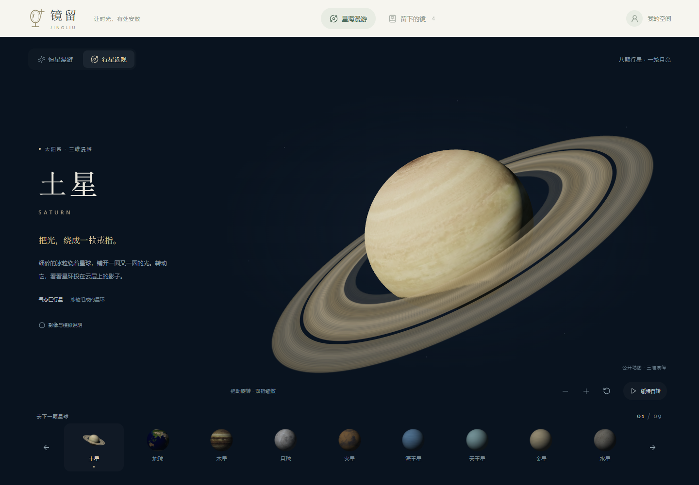
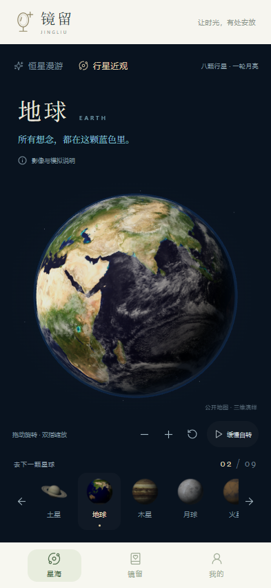
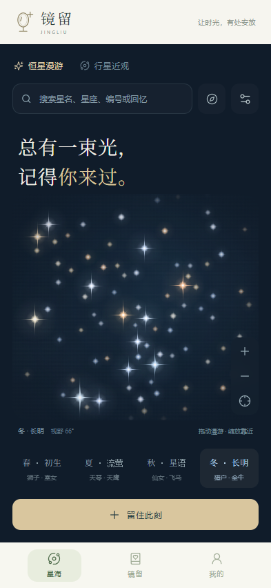
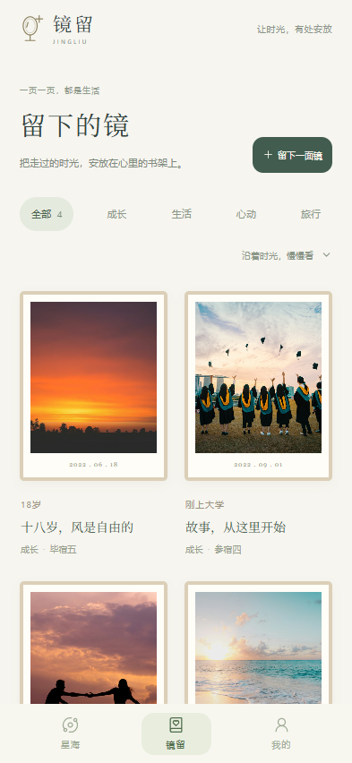

# 镜留 Jingliu

**把回忆，寄存在星光里。**

在 20,000 颗真实恒星之间漫游，把成长、相遇与普通日子里的微光，珍藏成一面镜。镜留提供四季星空、九个三维天体、私人记忆书架，以及可以离线使用的 Android 应用。

1.3.0 新增「行星近观」：旋转八颗行星与月球，靠近土星环、地球云层与月面细节。公开地图与补充的模拟纹理分别注明，星图仍保留四季分区与 20,000 颗恒星。

[下载 Android APK](https://github.com/xiao-zi-chen/jingliu/releases/download/v1.3.0/jingliu-1.3.0.apk) · [查看最新版本](https://github.com/xiao-zi-chen/jingliu/releases/latest) · [安装说明](release/安装说明.md)



## 在镜留，你可以

- **靠近三维星球**：从星海上方进入「行星近观」，探索八颗行星与月球。单指拖动旋转、双指或滚轮缩放，可重置视角、开启或暂停缓慢自转。土星有立体星环与投影，地球使用独立的云层与大气层，月球使用高程贴图表现凹凸。
- **漫游四时星海**：春 · 初生、夏 · 流萤、秋 · 星语、冬 · 长明。以名称与柔和色调区分，没有分隔线，点击入口即可抵达对应星空。
- **认识真实星辰**：20,000 颗恒星与 88 个星座，支持中文和英文星名、星座、HIP/HD/HR 编号搜索。查看距离、视星等、赤经赤纬和光谱，收藏喜欢的星星。
- **看见更有层次的星光**：亮核、渐变光晕与细长星芒，保留冷暖色温与明暗差异。支持拖动、双指缩放、星体大小调节及星海/旷野切换；星名、星座连线和网格默认关闭，放大后逐步呈现暗星。
- **留下一面镜**：记录文字、日期、人生标签与自己的照片，把回忆寄存在一颗星上。木质书架按成长、生活、心动、旅行分类，支持编辑、删除和定位。
- **带走珍贵回忆**：导入和导出包含照片、星星坐标及收藏的 JSON 备份。导入先预览，完整重复的记忆自动跳过，大备份自动分卷。

  

## Android 应用

下载安装包后传到手机，点击安装即可。最低支持 **Android 8.0**，当前版本 **1.3.0**，安装包约 **5.2 MiB**。

APK 内置星表、三维地图、图片和字体，离线可浏览星空与星球、保存记忆与收藏。三维模式需要设备支持 WebGL 2；不支持或图形上下文丢失时提供可切换的静态预览。照片选择、备份导入和导出使用 Android 系统文件选择器，无需申请相册或外部存储权限。系统返回键优先关闭搜索、弹窗和详情，再回到星空。

**当前 APK 使用本机离线书架，暂不提供账号登录或云端同步。** 记忆与照片保存在本机；换机、卸载或清除应用数据前，请先在「我的 → 带走我的回忆」中导出备份。照片存储有容量限制，空间不足时会提示。网站版保留账号服务，网站备份也可导入 APK。

## 本地运行网站

使用 Node.js 24 LTS（最低 22.13）。

```sh
npm ci
npm run dev
```

打开 <http://127.0.0.1:5173>。默认前端端口为 5173，账号服务为 4174；可用 `VITE_PORT` 和 `PORT` 环境变量调整。

```sh
npm run build
npm start
```

构建后，<http://127.0.0.1:4174> 同时提供网站与 API。账号数据默认保存在 `data/jingliu.sqlite`，体验书架保存在浏览器。注册后的账号书架从空白开始，与体验数据独立。密码使用 scrypt 加盐派生，会话使用 HttpOnly / SameSite Cookie，接口校验记忆所属账号。

项目尚未部署公网账号服务。公开部署需要持续运行的 Node 服务、持久化磁盘和 HTTPS 反向代理，并设置 `COOKIE_SECURE=true`。配置参考 [.env.example](.env.example)。

## 从源码构建 APK

Windows 环境需要 Node.js、JDK 17/21、Android SDK Platform 36 和 Build Tools 36.0.0。

```powershell
npm ci
npm run build:apk
```

也可以显式指定工具路径：

```powershell
powershell -NoProfile -ExecutionPolicy Bypass -File scripts/build-apk.ps1 -AndroidSdk "C:\Android\Sdk" -JavaHome "C:\Java\jdk-21"
```

脚本构建网页，执行 Android release 构建与 Lint，校验签名，生成 `release/jingliu-1.3.0.apk` 和 SHA-256 文件。Gradle Wrapper 与 Android 源码位于 `android/`。

首次构建会生成项目专属签名，保存在已被 Git 忽略的 `.android-signing/`。请保留该目录用于后续覆盖升级，不要提交或分享其中的私钥和密码。自行构建使用自己的密钥，不能直接覆盖安装使用另一把密钥签名的版本。

Windows 中间产物放在 `%LOCALAPPDATA%/JingliuBuild/<项目路径摘要>/`，避免外置 exFAT 盘的增量资源写入问题。APK 仅打包 `dist/` 中的页面资源，不包含账号服务器、数据库或签名私钥。

## 验证

```sh
npm test
npm run test:e2e
```

- 10 项接口与数据测试覆盖账号隔离、记忆读写、备份校验、持久化和旧恒星兼容。
- 50 项浏览器测试覆盖桌面和手机的搜索、点选、缩放、四季导航、照片、备份与记忆流程。Android 离线保存、导出和返回逻辑使用模拟桥接验证。
- 新增三维测试覆盖九个天体、旋转缩放、双指手势、静止与后台停止重绘、地图加载失败、不支持 WebGL 的静态预览与恢复、离线资源和小屏布局。
- 浏览器测试默认使用本机 Microsoft Edge，可通过 `PLAYWRIGHT_CHANNEL=chrome` 使用 Chrome。测试服务使用 5183/4176 端口及 `.artifacts/e2e.sqlite`，与日常数据分开。
- APK 通过 release 构建、Android Lint、签名和资源一致性检查。本次未连接 Android 真机，尚未实际安装验证。

## 星表与渲染

星图从 HYG v4.0 数据中选取 **20,000 颗较亮恒星**，保留完整的 88 个 Stellarium 西方星座。原有 59 颗亮星的标识保持兼容，另外 21,487 颗历史恒星作为兼容档案，只在已有记忆、收藏或备份引用时读取和显示。

四季星区按赤经划为四个连续的六小时区域，星表总数保持 20,000 颗。季节名称用于漫游导航，**不代表当前位置的实时天空**。坐标为 J2000 赤道坐标，距离为星表估计值；未实现地理定位、实时天象或精密观测计算，星云背景为视觉装饰。

星体默认大小为 1.65 倍，可调节到 1–2.5 倍。使用视口剔除、亮度排序和光晕贴图缓存，静止及后台页面停止重绘。默认微光密度为 4.5 等，初始视野优先呈现亮星；避免相邻光晕重叠，放大后逐步呈现暗星，已选择或关联回忆/收藏的星星始终保留。旧偏好首次迁移到 v4 时收起星名/连线/网格，并降低过高的密度；本机记忆、收藏和星体大小保留。

单份备份最多导入 24 MiB、2,000 段记忆，分卷可按任意顺序导入。导入添加内容，不覆盖已有记忆。照片支持 JPG/PNG/WebP，单张上限 12 MiB，保存前自动压缩。

## 项目结构

```text
src/App.tsx             页面、书架、记忆编辑及交互
src/SkyCanvas.tsx       星空投影、星芒渲染和手势
src/Planetarium.tsx     三维天体浏览与布局
src/planet-renderer.ts  球体、星环、光照、手势与资源回收
src/planets.ts          天体介绍、公开地图与模拟来源
scripts/prepare-planets.py  离线地图整理与模拟纹理生成
src/sky-regions.ts      四季星区和星数统计
src/catalog.ts         星表、搜索索引和坐标
src/StarTools.tsx       搜索、星座浏览及恒星资料
src/memory-utils.ts     照片处理、备份校验及分卷
src/platform.ts        Android 环境与桥接声明
server/                网站账号服务与 SQLite 数据库
shared/                星表及共用校验
android/               Android 容器及 Gradle 构建
scripts/build-apk.ps1   APK 构建、签名和校验
public/                本地封面、字体和来源说明
tests/                 接口与浏览器测试
release/               本机 APK 输出及安装说明
```

## 数据与素材来源

- 三维地球、月球、木星、火星与土星采用 NASA 公开地图；其余云层或地貌与土星环由程序绘制。详细出处与修改见 [天体素材说明](public/textures/planets/credits.md)。星球尺寸、光照与动画用于欣赏，不提供实时位置或精密观测计算。
- Three.js：MIT 许可，完整声明见 [Three.js License](public/licenses/three-LICENSE.txt)。
- 恒星数据：[HYG Database](https://github.com/astronexus/HYG-Database)，CC BY-SA 4.0。使用 v4.0 数据，星数筛选和兼容档案由本项目整理。
- 星座连线：[Stellarium Western sky culture](https://github.com/Stellarium/stellarium/tree/master/skycultures/western)。声明见 [星表来源说明](public/catalog-credits/)。
- 中文字体：Noto Serif SC，本地子集，许可见 [OFL.txt](public/fonts/OFL.txt)。
- 图标：Lucide，ISC 许可。镜留标识、木质书架和星空由 SVG、CSS 和 Canvas 绘制。
- 预置封面：Unsplash，以下图片随项目本地提供。

| 封面 | 原始图片 |
| --- | --- |
| 日出 | [photo-1472120435266-53107fd0c44a](https://images.unsplash.com/photo-1472120435266-53107fd0c44a) |
| 校园 | [photo-1541339907198-e08756dedf3f](https://images.unsplash.com/photo-1541339907198-e08756dedf3f) |
| 心动 | [photo-1474552226712-ac0f0961a954](https://images.unsplash.com/photo-1474552226712-ac0f0961a954) |
| 山海 | [photo-1507525428034-b723cf961d3e](https://images.unsplash.com/photo-1507525428034-b723cf961d3e) |
| 旷野 | [photo-1441974231531-c6227db76b6e](https://images.unsplash.com/photo-1441974231531-c6227db76b6e) |
| 星夜 | [photo-1419242902214-272b3f66ee7a](https://images.unsplash.com/photo-1419242902214-272b3f66ee7a) |
